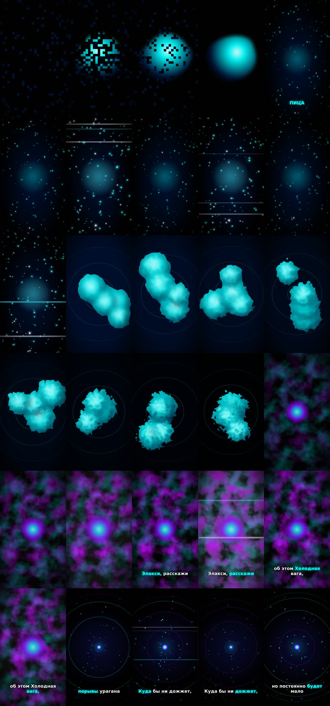

# WATER — ELOX1M & ghasaii · vertical motion video

Remotion project: 1080×1920, 30 fps, TikTok-style captions, five beat-synced scenes.

## Setup

```bash
npm install
# The track is not committed (public repo, copyrighted audio):
curl -L -A "Mozilla/5.0 (Windows NT 10.0; Win64; x64) AppleWebKit/537.36" \
  -o public/water.mp3 "https://eu.monfons.com/dl/1519610468/elox1m_ghasaii_-_WATER_(eu.monfons.com).mp3"
```

## Pipeline

| Step | Command |
| --- | --- |
| BPM | `python scripts/bpm.py public/water.mp3` → **152 BPM**, first beat 0.07 s |
| Captions | `python scripts/transcribe.py public/water.mp3 public/water-captions.json` (faster-whisper `large-v3-turbo`, `ru`) |
| Render | `npx remotion render src/index.ts WaterVideo out/video.mp4 --width=1080 --height=1920 --fps=30` |
| Mux | `ffmpeg -i out/video.mp4 -i public/water.mp3 -c:v copy -c:a aac -map 0:v -map 1:a -shortest out/final.mp4` |
| Contact sheet | `ffmpeg -i out/final.mp4 -vf "select='not(mod(n,30))',scale=270:480,tile=5x6" -frames:v 1 out/contact-sheet.jpg` |

Python deps: `pip install librosa faster-whisper`.

`lyrics-transcriber` was tried first, but it has no local Whisper backend (only RunPod / AudioShake
cloud providers that need API keys) and produced no output, so transcription runs Whisper locally.

## Structure

- `src/config.ts` — `CONFIG` with every animation parameter
- `src/Video.tsx` — assembles scenes (`<Sequence>` with crossfades), `<Audio>`, overlay, captions
- `src/scenes/` — `BlobDissolve` (0–3 s), `PulseParticles` (3–10 s), `LiquidMorph` (10–18 s), `VioletSmoke` (18–25 s), `Collapse` (25 s–end)
- `src/Captions.tsx` — `createTikTokStyleCaptions`, active word `#00FFFF`
- `src/beat.ts`, `src/components/Glitch.tsx` — beat grid and beat-synced glitch


